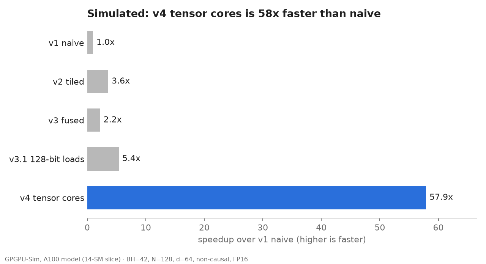

# Phantom A100: CUDA Attention Optimization Under GPU Access Constraints

> I used transformer attention as a stress test to investigate how far you can optimize modern AI
> kernels for datacenter GPUs when you don't have access to the target GPU.

**Research question:** how far can high-performance GPU kernel engineering be pushed without physical
access to datacenter-class accelerators? Transformer attention is the test workload: memory-bound,
computationally demanding, and central to modern AI.

**What was built:** six progressively optimized CUDA attention kernels for an A100-class GPU, from a
naive implementation through shared-memory tiling, kernel fusion with online softmax, vectorized
memory access, `cp.async` double buffering, and Tensor Core (WMMA) execution. Each step targets a cost
identified by architectural reasoning: redundant memory traffic, the N×N score matrix, load
instructions, memory latency, and FP32 math throughput.

**How it was evaluated:** cycle-level simulation of an A100 (GPGPU-Sim), with no A100 involved. The
simulator verified every kernel and exposed register pressure and occupancy as the limiting factors.
Result: a **57.9× simulated speedup** over the baseline and **~52 TFLOP/s projected** for a full
A100-class configuration.

**What it took:** GPGPU-Sim had to be debugged and patched before its answers could be trusted, in its
Tensor Core (WMMA) emulation, warp shuffles, and the A100 config's instruction latencies. The study shows
that architectural simulation can support meaningful GPU performance engineering when accelerator
hardware is out of reach, and it maps where that support ends: absolute speed, a FlashAttention-2
comparison, and features the simulator does not model (`cp.async`).

The claim is "my simulator predicts", never "my kernel achieves". Every number in this repo is labeled
**Simulated** (GPGPU-Sim) or **Measured** (real hardware, optional; see the end).

## Findings: what you can and cannot learn without the GPU

| Question | Answerable without the GPU? | Evidence (Simulated) |
| --- | --- | --- |
| Is each kernel correct? | **Yes, fully.** The simulator executes the real kernel code. | 24 of 24 runs pass, all 6 kernels, causal and non-causal, non-tile-aligned N |
| Which optimizations help, and in what order? | **Yes.** Ratios between versions on the same model are the reliable output. | v2 3.6×, v3.1 5.4×, v4 57.9× over naive |
| Why is a kernel slow? | **Yes.** Simulator counters expose the bottleneck. | v3 fused sits at ~10% occupancy (236 registers per thread) and is *slower* than v2 at N = 128; v3.1 cuts registers to ~165, doubles occupancy, 2.5× faster |
| How fast is it on a real A100? | **Only as a prediction.** The simulator runs PTX, not the SASS the hardware runs, and is not calibrated here. | ~52 TFLOP/s predicted (14-SM slice scaled to 108 SMs) |
| Does an optimization the simulator doesn't model help? | **No.** | v3.2's `cp.async` double buffering is implemented and checked for correctness, but its speed can't be evaluated |
| How does it compare with FlashAttention-2? | **No.** Third-party and vendor kernels don't run in the simulator. | none |
| Can the simulator be trusted out of the box? | **No.** It had to be debugged first. | 5 fixes: warp shuffles returned 0, shuffle latency was uninitialized (~1,000× too slow), 3 Tensor Core emulation bugs |

The last row is the main cost of the method: when a kernel fails in simulation, the bug can be in your
kernel or in the simulator. Here, v2 "failed" because of a simulator bug, which was isolated with
small standalone tests of each primitive (exp, shuffle, WMMA) before any kernel result was trusted.

| Version | Python | What changes | Bottleneck removed | Scores in HBM? |
| --- | --- | --- | --- | --- |
| v1 | `naive` | 3 kernels: S = QKᵀ (thread per score), softmax (thread per row), O = PV | baseline | yes |
| v2 | `tiled` | 32×32 shared-memory tiles, padded against bank conflicts; warp-per-row softmax with shuffles | redundant global reads | yes |
| v3 | `fused` | one kernel, thread per query row, K/V streamed through shared memory, online softmax (log2 domain) | the N×N score matrix | **no** |
| v3.1 | `fused_vec` | 128-bit loads/stores, K/V kept as FP16 in shared memory | load instruction count, smem footprint | no |
| v3.2 | `fused_db` | + double-buffered K/V tiles with `cp.async` (sm_80+) | global-memory latency | no |
| v4 | `fused_tc` | 4 warps × 16 rows; QKᵀ and PV on tensor cores (WMMA m16n16k16, FP32 accumulate) | FP32 CUDA-core math | no |

`fused_tuned(q, k, v, causal, double_buffer, br, bc)` exposes the v3.1/v3.2 kernel at every compiled
tile size, (BR, BC) ∈ {(64,32), (64,64), (128,32), (128,64)}, for the tile sweep.

## What the compiler reports (CUDA 13.2, `-Xptxas -v`)

All 84 kernel instantiations build for sm_75 (T4), sm_80 (A100), sm_89 (L4) and sm_90 (H100)
with **zero register spills**.

| Kernel | Registers (sm_80) | Shared memory per block | Threads per block |
| --- | --- | --- | --- |
| v3 `fused` | 236 | 24.8 KB static | 64 |
| v3.1 / v3.2 (64×32) | 168 / 161 | 16.3 KB / 24.3 KB dynamic | 64 |
| v4 `fused_tc` | 80 | 61.0 KB dynamic | 128 |

The PTX confirms `cp.async` copies in v3.2 and `wmma.mma.sync` in v4. These are compile-time facts
only; runtime numbers are in Simulated results below.

## Simulated results

GPGPU-Sim (patched, see `sim/README.md`) running the unmodified kernels on its SM80_A100 model,
14-SM slice. Data: `results/simulated/`.



| Version | Speedup over naive (BH=42, N=128) | % of peak | Occupancy |
| --- | --- | --- | --- |
| v1 naive | 1.0× | 3.2% FP32 | 49% |
| v2 tiled | 3.6× | 11.5% FP32 | 50% |
| v3 fused | 2.2× | 7.0% FP32 | 10% |
| v3.1 128-bit loads | 5.4× | 17.4% FP32 | 19% |
| v3.2 double buffer | correctness only (no `cp.async` in the simulator) | | |
| v4 tensor cores | 57.9× | 11.7% tensor (16.8% at N=1,024) | 37% |

All six versions pass correctness in the simulator: 24 of 24 runs (N = 64 and 100, causal on and off),
max error 9.5e-4 against a float64 reference. Full tables: `results/simulated/README.md`.

What the Simulated numbers say:

- **Tensor cores are the step change.** v4 does the two matmuls on tensor cores and is 10.8× faster
  than the best CUDA-core version (v3.1). Its throughput rises with sequence length (4.7 → 6.8 TFLOP/s
  on the slice from N = 128 to 1,024) as fixed per-tile costs are amortized.
- **Fusion alone did not pay at N = 128.** v3 is slower than v2: at this length v2's N×N buffer fits in
  L2, while v3 runs one thread per query row with 236 registers, so occupancy falls to ~10% and the
  kernel is latency-bound. v3.1 cuts registers to ~165 and loads 128 bits at a time, which roughly
  doubles occupancy and makes it 2.5× faster than v3. The benefit of never writing the N×N matrix
  grows with N; simulating the slower kernels at long sequences takes hours per point, so only v4 was run there.
- **v4 sits at 12% to 17% of tensor-core peak.** Because WMMA fragment layouts are opaque, v4 runs the
  softmax and the O rescale through shared memory every tile. FlashAttention-2 keeps them in registers
  with raw `mma.sync`, which is the next step.

Getting the simulator to run these kernels correctly meant fixing five problems in GPGPU-Sim and its
A100 config: three in tensor-core (WMMA) emulation, a warp-shuffle bug that returned 0 for every
`__shfl_xor_sync`, and an uninitialized shuffle latency (~22,000 cycles per shuffle). Details and
patches are in `sim/README.md` and `sim/patches/`.

## Layout

```
csrc/
  kernels/              the six kernels as plain CUDA headers (no PyTorch): naive, tiled, fused,
                        fused_tuned (v3.1/v3.2), fused_tc (v4); shared by PyTorch and the simulator
  attn_*.cu             thin PyTorch wrappers, one per version
  common.cuh            PyTorch-side helpers, dtype dispatch
  bindings.cpp          input checks, Python entry points
sim/                    GPGPU-Sim harness, A100 configs, simulator patches, runner, report
results/simulated/      Simulated results (GPGPU-Sim)
results/measured/       Measured results (real GPU), filled by scripts/run_all.sh
analysis/               analytical model and FlashAttention paper checks (context, not results)
cuda_attn/              Python API + online_softmax_ref.py (NumPy model of the fused algorithm)
tests/
  test_algorithm.py     CPU: online softmax == textbook softmax; fp16 P rounding fits the tolerance
  test_correctness.py   GPU: every kernel and tile config vs FP32 SDPA, odd N, causal, overflow
bench/
  benchmark.py          full sweep → results/measured/bench_<gpu>.csv
  sweep_tiles.py        (BR, BC) × buffering sweep → results/measured/tiles_<gpu>.csv
  plot.py               CSV → throughput/memory plots + summary.md with the headline
  run_one.py, profile.sh   Nsight Compute / Nsight Systems
scripts/run_all.sh      the whole paid-GPU session in one command
notebooks/colab_run.ipynb   build, test, benchmark on Colab
```

## Run it

On a rented A100/L4 (one session, everything lands in `results.tar.gz`):

```bash
bash scripts/run_all.sh
```

Step by step:

```bash
MAX_JOBS=4 pip install -e . --no-build-isolation     # ~10 min: 6 kernels x 5 architectures
pip install flash-attn --no-build-isolation          # Ampere or newer only
python -m pytest -q tests                            # correctness gate, always first
python bench/benchmark.py                            # B=4, H=16, d=64, N=512..8192, causal off/on
python bench/sweep_tiles.py
python bench/plot.py results/measured/bench_<gpu>.csv
bash bench/profile.sh
```

```python
import torch, cuda_attn
q, k, v = (torch.randn(4, 16, 4096, 64, device="cuda", dtype=torch.float16) for _ in range(3))
o = cuda_attn.fused_tc(q, k, v, causal=True)
```

No GPU? `python -m pytest tests/test_algorithm.py` checks the math on CPU. The Colab notebook runs
everything on a free T4, except the FlashAttention-2 baseline, which needs Ampere or newer.

## Optional: checking the predictions on hardware

The project's claims stand on simulation alone. If an A100 becomes available, `bash scripts/run_all.sh`
(about 2 hours) adds **Measured** results in `results/measured/`: real throughput for every version, the
FlashAttention-2 comparison, v3.2's double buffering, and, most interesting for the research question,
how far each Simulated prediction was from reality.

## Methodology

- **FLOPs:** 4·B·H·N²·d per forward pass, halved for causal (FlashAttention convention).
- **Timing:** 10 warm-ups, 100 timed runs with CUDA events, L2 flushed before each run; median and p10/p90.
- **Correctness gate:** each benchmark row is checked against FP32 SDPA first (≤ 2e-3 max abs error in FP16);
  a wrong kernel is recorded as `wrong_result`, never timed.
- **Memory:** peak extra allocation during one call. Unfused kernels that cannot fit their N×N buffer are
  recorded as `skipped_oom` (at B=4, H=16, N=8192 that buffer is 17 GB in FP32), which is itself a result.
- **Profiling:** DRAM throughput, SM throughput, achieved occupancy, shared-memory bank conflicts and
  total HBM bytes per kernel at N = 4096.

## Known gaps to FlashAttention-2 (next steps)

- v4 keeps the O accumulator and the softmax in shared memory because WMMA fragment layouts are
  opaque. Raw `mma.sync` with a known register layout keeps them in registers.
- v4 loads K/V synchronously; combining it with v3.2's `cp.async` pipeline is the next experiment.
- Backward pass, head dimension 128, BF16.

## References

- Dao et al., *FlashAttention*, 2022. https://arxiv.org/abs/2205.14135
- Dao, *FlashAttention-2*, 2023. https://arxiv.org/abs/2307.08691
- Milakov and Gimelshein, *Online normalizer calculation for softmax*, 2018. https://arxiv.org/abs/1805.02867
- NVIDIA, *CUDA C++ Programming Guide*: warp matrix functions (WMMA), asynchronous data copies (`cp.async`).
