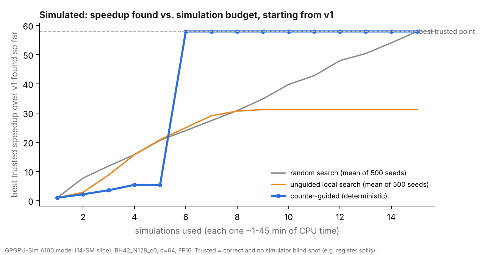

# Counter-guided optimization: results (Simulated)

Every number here is **Simulated**: GPGPU-Sim (patched, `sim/patches/`) on its SM80_A100 model cut to a 14-SM slice, workload BH42_N128_c0 (BH = batch x heads, N = sequence length, d = 64, FP16). No real GPU was used. Generated by `python -m autotune.experiments`.

## Ground truth: every sim-verifiable design point

The design space has 23 points; 15 can be judged by the simulator (the double-buffered ones cannot: no `cp.async`). All of them were simulated once to score the searches. *Trusted* = passes the correctness check and has no known simulator blind spot.

| Rank | Design point | Cycles | Speedup vs v1 | Occupancy | Regs (sim / sm_80) | Spills (sm_80) | Blocks/SM (limit) | L2 traffic x | Insn/FLOP | Trusted |
|---|---|---|---|---|---|---|---|---|---|---|
| 1 | fused_tc (v4 fused_tc) | 52,659 | 57.9x | 36.7% | 80 / 80 | 0 B | 6 (regs) | 2.12 | 0.13 | yes |
| 2 | fused_vec/br128/bc64/r128 | 559,186 | 5.5x | 18.7% | 128 / 128 | 168 B | 4 (regs) | 1.44 | 2.04 | **no** |
| 3 | fused_vec/br128/bc64 | 559,326 | 5.5x | 18.7% | 168 / 168 | 0 B | 3 (regs) | 1.44 | 2.04 | yes |
| 4 | fused_vec/br128/bc32/r128 | 561,541 | 5.4x | 18.7% | 128 / 128 | 168 B | 4 (regs) | 1.44 | 2.04 | **no** |
| 5 | fused_vec/br128/bc32 | 561,725 | 5.4x | 18.7% | 168 / 168 | 0 B | 3 (regs) | 1.44 | 2.04 | yes |
| 6 | fused_vec/br64/bc64/r128 | 563,691 | 5.4x | 18.7% | 128 / 128 | 168 B | 8 (regs) | 1.94 | 2.05 | **no** |
| 7 | fused_vec/br64/bc64 | 563,975 | 5.4x | 18.7% | 168 / 168 | 0 B | 6 (regs) | 1.94 | 2.05 | yes |
| 8 | fused_vec/br64/bc32/r128 | 565,540 | 5.4x | 18.7% | 128 / 128 | 168 B | 8 (regs) | 1.94 | 2.05 | **no** |
| 9 | fused_vec/br64/bc32 (v3.1 fused_vec) | 565,972 | 5.4x | 18.7% | 168 / 168 | 0 B | 6 (regs) | 1.94 | 2.05 | yes |
| 10 | fused/br128/bc32/r128 | 686,124 | 4.4x | 18.6% | 128 / 128 | 188 B | 4 (regs) | 8.5 | 1.24 | **no** |
| 11 | fused/br64/bc32/r128 | 732,923 | 4.2x | 18.6% | 128 / 128 | 188 B | 6 (shmem) | 9.0 | 1.31 | **no** |
| 12 | tiled (v2 tiled) | 855,959 | 3.6x | 51.8% | 44 / 32 | 0 B | 1 (regs) | 8.23 | 2.57 | yes |
| 13 | fused/br128/bc32 | 1,333,912 | 2.3x | 11.4% | 242 / 168 | 0 B | 2 (regs) | 8.16 | 1.24 | yes |
| 14 | fused/br64/bc32 (v3 fused) | 1,410,914 | 2.2x | 9.8% | 242 / 168 | 0 B | 4 (regs) | 7.77 | 1.32 | yes |
| 15 | naive (v1 naive) | 3,049,245 | 1.0x | 47.3% | 55 / 31 | 0 B | 4 (regs) | 17.86 | 3.67 | yes |

Best trusted point: **fused_tc (v4 fused_tc)**, 52,659 cycles (57.9x over v1). Target for the comparisons below: within 5% of it.

## 1. Rediscovery from v1 (never told the v1 -> v4 path)

Path taken: naive (v1 naive) -> tiled (v2 tiled) -> fused/br64/bc32 (v3 fused) -> fused_vec/br64/bc32 (v3.1 fused_vec) -> fused_tc (v4 fused_tc)

Simulations used: 7 of 15. Stop reason: step 5: no untried transformation in the menu targets the diagnosed bottlenecks of fused_tc.

Historical versions on the path: v1 naive, v2 tiled, v3 fused, v3.1 fused_vec, v4 fused_tc.

Ablation, pure greedy (no unlock move): naive (v1 naive) -> tiled (v2 tiled); best trusted tiled (v2 tiled) at 855,959 cycles after 3 simulations. Stop reason: step 2: no untried transformation in the menu targets the diagnosed bottlenecks of tiled.

### Decision trace

**Step 1**: incumbent `naive` (3,049,245 cycles). Diagnosed:

- cuda_core_math_bound (severity 7.34): 3.67 thread instructions per FLOP (tensor-core kernels are < 0.2)
- redundant_global_traffic (severity 5.95): L2 traffic 17.9x compulsory
- materialized_intermediate (severity 4.46): 3 launches, L2 traffic 17.9x compulsory

| Tried | Targets | Score | Predicted -> observed (counter: declared / change) | Agreement | Speedup | Verdict | Trusted |
|---|---|---|---|---|---|---|---|
| `fuse` -> `fused/br64/bc32` | redundant_global_traffic, materialized_intermediate | 5.208 | kernel_launches: - / -67%; l2_accesses: - / -57%; dram_sectors: - / -100%; regs: + / +340%; occupancy: - / -79%; cycles: - / -54% | 1.00 | 2.16x | confirmed | yes |
| `tile_smem` -> `tiled` | redundant_global_traffic | 2.976 | global_load_insn: - / -96%; l2_accesses: - / -54%; shmem_insn: + / new; kernel_launches: 0 / +0%; cycles: - / -72% | 1.00 | 3.56x | confirmed | yes |

**Step 2**: incumbent `tiled` (855,959 cycles). Diagnosed:

- cuda_core_math_bound (severity 5.14): 2.57 thread instructions per FLOP (tensor-core kernels are < 0.2)
- redundant_global_traffic (severity 2.74): L2 traffic 8.2x compulsory
- materialized_intermediate (severity 2.06): 3 launches, L2 traffic 8.2x compulsory

*Unlock move:* no trusted improvement; blocked bottleneck(s) cuda_core_math_bound have no remedy from tiled. Taking non-improving `fuse` -> fused/br64/bc32 (0.61x) because it makes tensor_cores applicable.

**Step 3**: incumbent `fused/br64/bc32` (1,410,914 cycles). Diagnosed:

- cuda_core_math_bound (severity 2.63): 1.32 thread instructions per FLOP (tensor-core kernels are < 0.2)
- redundant_global_traffic (severity 2.59): L2 traffic 7.8x compulsory
- register_limited_occupancy (severity 2.56): 4 blocks/SM limited by registers (242 regs/thread), occupancy 9.8%
- latency_bound (severity 1.55): 77% of scheduler cycles stalled on dependencies, occupancy 9.8%

| Tried | Targets | Score | Predicted -> observed (counter: declared / change) | Agreement | Speedup | Verdict | Trusted |
|---|---|---|---|---|---|---|---|
| `vectorize_fp16` -> `fused_vec/br64/bc32` | redundant_global_traffic, register_limited_occupancy | 2.575 | global_load_insn: - / -88%; l2_accesses: - / -75%; regs: - / -31%; occupancy: + / +92%; cycles: - / -60% | 1.00 | 2.49x | confirmed | yes |
| `reg_cap_128` -> `fused/br64/bc32/r128` | register_limited_occupancy, latency_bound | 2.054 | regs: - / -47%; occupancy: + / +91%; cta_per_sm: + / +50%; cycles: - / -48% | 1.00 | 1.93x | confirmed | no: ptxas spills 188 bytes/thread on sm_80; the simulator runs PTX and does not charge for spills |

**Step 4**: incumbent `fused_vec/br64/bc32` (565,972 cycles). Diagnosed:

- cuda_core_math_bound (severity 4.11): 2.05 thread instructions per FLOP (tensor-core kernels are < 0.2)
- register_limited_occupancy (severity 1.34): 6 blocks/SM limited by registers (168 regs/thread), occupancy 18.7%
- latency_bound (severity 1.27): 63% of scheduler cycles stalled on dependencies, occupancy 18.7%

| Tried | Targets | Score | Predicted -> observed (counter: declared / change) | Agreement | Speedup | Verdict | Trusted |
|---|---|---|---|---|---|---|---|
| `tensor_cores` -> `fused_tc` | cuda_core_math_bound | 2.053 | thread_insn: - / -94%; warp_insn: - / -93%; regs: - / -52%; cycles: - / -91% | 1.00 | 10.75x | confirmed | yes |
| `reg_cap_128` -> `fused_vec/br64/bc32/r128` | register_limited_occupancy, latency_bound | 1.302 | regs: - / -24%; occupancy: + / +0%; cta_per_sm: + / +33%; cycles: - / -0% | 0.67 | 1.00x | mechanism_no_gain | no: ptxas spills 168 bytes/thread on sm_80; the simulator runs PTX and does not charge for spills |

**Step 5**: incumbent `fused_tc` (52,659 cycles). Diagnosed:

- smem_bank_conflicts (severity 1.48): 0.07 conflicts per shared-memory instruction

### Hardware-only candidates (proposed, not simulated)

- `double_buffer` on `fused_vec/br64/bc32` -> `fused_vec/br64/bc32/db` (targets latency_bound): cp.async double buffering is not implemented in GPGPU-Sim (the sm_75 PTX path falls back to synchronous copies)

## 2. Robustness: the same search from every starting point

| Start | Sims | Best trusted found | Cycles | Within 5% of best | Stop reason |
|---|---|---|---|---|---|
| fused/br64/bc32 (v3 fused) | 5 | fused_tc (v4 fused_tc) | 52,659 | yes | step 3: no untried transformation in the menu targets the diagnosed bottlenecks of fused_tc |
| fused/br64/bc32/r128 | 5 | fused_tc (v4 fused_tc) | 52,659 | yes | step 2: no untried transformation in the menu targets the diagnosed bottlenecks of fused_tc |
| fused/br128/bc32 | 5 | fused_tc (v4 fused_tc) | 52,659 | yes | step 3: no untried transformation in the menu targets the diagnosed bottlenecks of fused_tc |
| fused/br128/bc32/r128 | 4 | fused_tc (v4 fused_tc) | 52,659 | yes | step 2: no untried transformation in the menu targets the diagnosed bottlenecks of fused_tc |
| fused_tc (v4 fused_tc) | 1 | fused_tc (v4 fused_tc) | 52,659 | yes | step 1: no untried transformation in the menu targets the diagnosed bottlenecks of fused_tc |
| fused_vec/br64/bc32 (v3.1 fused_vec) | 3 | fused_tc (v4 fused_tc) | 52,659 | yes | step 2: no untried transformation in the menu targets the diagnosed bottlenecks of fused_tc |
| fused_vec/br64/bc32/r128 | 3 | fused_tc (v4 fused_tc) | 52,659 | yes | step 2: no untried transformation in the menu targets the diagnosed bottlenecks of fused_tc |
| fused_vec/br64/bc64 | 3 | fused_tc (v4 fused_tc) | 52,659 | yes | step 2: no untried transformation in the menu targets the diagnosed bottlenecks of fused_tc |
| fused_vec/br64/bc64/r128 | 3 | fused_tc (v4 fused_tc) | 52,659 | yes | step 2: no untried transformation in the menu targets the diagnosed bottlenecks of fused_tc |
| fused_vec/br128/bc32 | 3 | fused_tc (v4 fused_tc) | 52,659 | yes | step 2: no untried transformation in the menu targets the diagnosed bottlenecks of fused_tc |
| fused_vec/br128/bc32/r128 | 3 | fused_tc (v4 fused_tc) | 52,659 | yes | step 2: no untried transformation in the menu targets the diagnosed bottlenecks of fused_tc |
| fused_vec/br128/bc64 | 3 | fused_tc (v4 fused_tc) | 52,659 | yes | step 2: no untried transformation in the menu targets the diagnosed bottlenecks of fused_tc |
| fused_vec/br128/bc64/r128 | 3 | fused_tc (v4 fused_tc) | 52,659 | yes | step 2: no untried transformation in the menu targets the diagnosed bottlenecks of fused_tc |
| naive (v1 naive) | 7 | fused_tc (v4 fused_tc) | 52,659 | yes | step 5: no untried transformation in the menu targets the diagnosed bottlenecks of fused_tc |
| tiled (v2 tiled) | 6 | fused_tc (v4 fused_tc) | 52,659 | yes | step 4: no untried transformation in the menu targets the diagnosed bottlenecks of fused_tc |

## 3. Same simulation budget: guided vs unguided vs random (start: v1)

Unguided local search uses the same transformation menu and acceptance rule as the guided search but ignores counters (random neighbour order); random search samples design points uniformly. Both averaged over 500 seeds. Each simulation costs 1 to 45 minutes of CPU time here, so *simulations to reach a good kernel* is the cost that matters.

| Strategy | Runs that reached within 5% of best | Mean sims to reach it (runs that did) | Median | Mean best cycles at full budget |
|---|---|---|---|---|
| Counter-guided | 100% | 6 | 6 | 52,659 |
| Unguided local search | 51% | 5.1 | 5.0 | 447,883 |
| Random search | 100% | 8.5 | 9.0 | 52,659 |

## 4. Signature audit: were the declared counter signatures right?

A counter 'moved' if it changed by more than 3%. Observed signs are listed in the order the transformation was applied during the rediscovery run.

| Transformation | Counter | Declared | Observed | Status |
|---|---|---|---|---|
| `tile_smem` | global_load_insn | - | - | holds |
| `tile_smem` | l2_accesses | - | - | holds |
| `tile_smem` | shmem_insn | + | + | holds |
| `tile_smem` | kernel_launches | 0 | 0 | holds |
| `tile_smem` | cycles | - | - | holds |
| `fuse` | kernel_launches | - | - | holds |
| `fuse` | l2_accesses | - | - | holds |
| `fuse` | dram_sectors | - | - | holds |
| `fuse` | regs | + | + | holds |
| `fuse` | occupancy | - | - | holds |
| `fuse` | cycles | - | - | holds |
| `vectorize_fp16` | global_load_insn | - | - | holds |
| `vectorize_fp16` | l2_accesses | - | - | holds |
| `vectorize_fp16` | regs | - | - | holds |
| `vectorize_fp16` | occupancy | + | + | holds |
| `vectorize_fp16` | cycles | - | - | holds |
| `tensor_cores` | thread_insn | - | - | holds |
| `tensor_cores` | warp_insn | - | - | holds |
| `tensor_cores` | regs | - | - | holds |
| `tensor_cores` | cycles | - | - | holds |
| `reg_cap_128` | regs | - | -- | holds |
| `reg_cap_128` | occupancy | + | +0 | wrong |
| `reg_cap_128` | cta_per_sm | + | ++ | holds |
| `reg_cap_128` | cycles | - | -0 | mostly holds |

## Method (as run)

- Bottleneck rules (`autotune/diagnose.py`), fixed before any search was run:
  - `materialized_intermediate`: more than one kernel launch AND L2 traffic > 4x compulsory
  - `redundant_global_traffic`: L2 traffic > 3x compulsory (Q, K, V, O moved once)
  - `register_limited_occupancy`: resident blocks limited by registers AND occupancy < 25%
  - `smem_limited_occupancy`: resident blocks limited by shared memory AND occupancy < 25%
  - `latency_bound`: > 50% of scheduler cycles stalled on dependencies (scoreboard) AND occupancy < 30%
  - `cuda_core_math_bound`: > 0.5 thread instructions per attention FLOP (matmuls run as scalar FMAs)
  - `smem_bank_conflicts`: > 0.05 bank conflicts per shared-memory instruction
  - `low_parallelism`: < 0.75 waves of blocks (SMs left idle)
  - `register_spills`: ptxas for sm_80 reports spill stores/loads for the kernel (static check, not simulated)
- Transformation menu (`autotune/transforms.py`): `tile_smem`, `fuse`, `vectorize_fp16`, `tensor_cores`, `reg_cap_128`, `remove_reg_cap`, `grow_br`, `shrink_br`, `grow_bc`, `shrink_bc`, `double_buffer`.
- Candidate score = sum of targeted bottleneck severities x Beta-posterior confidence of (bottleneck, transformation); beam 2; a step must improve cycles by >= 2% with a trusted result; 'moved as declared' = at least 67% of declared counters match.
- Spills are found statically (`ptxas -v` for sm_80), because the simulator executes PTX and cannot see them.

## What this does not show yet

- Whether the simulated ranking holds on a real A100: run `autotune/validate_hw.py` (Measured).
- Generalization beyond attention: the menu and thresholds were written for this kernel family.
- One workload only. Re-run `groundtruth` + `experiments` with other `--BH/--N/--causal` to test.
