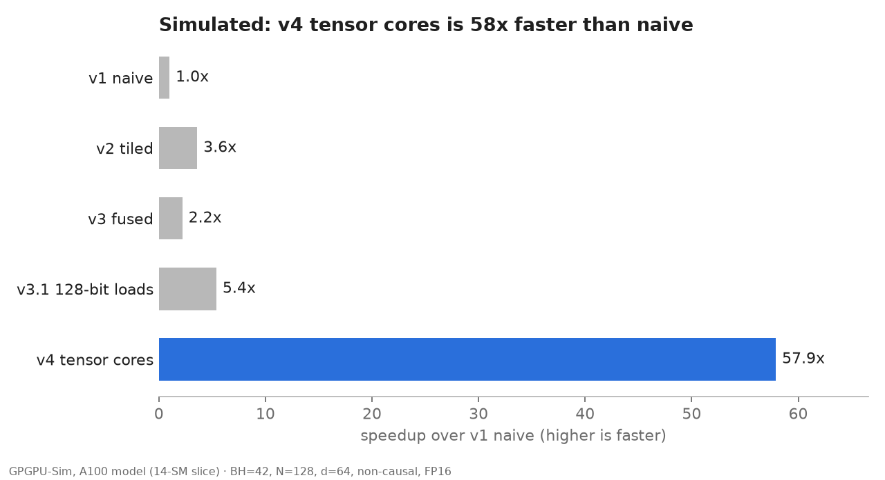

# Results: Simulated

Every number on this page is **Simulated**: GPGPU-Sim (accel-sim fork, dev @ 4195dd4, with the
fixes in `sim/patches/`) executing the kernels' PTX on its SM80_A100 model, cut to a 14-SM slice
(5 of 40 memory channels, same per-SM bandwidth and L2). Real-GPU numbers will be labeled **Measured**.

## Correctness (Simulated)

| Version | Runs | Passed | Max abs error | Shapes |
|---|---|---|---|---|
| v1 naive | 4 | 4 | 9.5e-04 | BH=2; N=100, N=100 causal, N=64, N=64 causal |
| v2 tiled | 4 | 4 | 9.5e-04 | BH=2; N=100, N=100 causal, N=64, N=64 causal |
| v3 fused | 4 | 4 | 9.5e-04 | BH=2; N=100, N=100 causal, N=64, N=64 causal |
| v3.1 128-bit loads | 4 | 4 | 9.5e-04 | BH=2; N=100, N=100 causal, N=64, N=64 causal |
| v3.2 double buffer* | 4 | 4 | 9.5e-04 | BH=2; N=100, N=100 causal, N=64, N=64 causal |
| v4 tensor cores | 4 | 4 | 9.5e-04 | BH=2; N=100, N=100 causal, N=64, N=64 causal |

Pass = max abs error ≤ 2e-3 vs a float64 CPU reference on the same FP16 inputs.

## Performance (Simulated)

| Version | BH | N | Causal | Cycles | Time (ms, slice) | TFLOP/s (slice) | TFLOP/s, A100-equivalent | % of peak | Speedup vs naive | Occupancy |
|---|---|---|---|---|---|---|---|---|---|---|
| v1 naive | 42 | 128 | no | 3,049,245 | 2.163 | 0.081 | 0.63 | 3.2% fp32 | 1.0x | 49.2% |
| v2 tiled | 42 | 128 | no | 855,959 | 0.607 | 0.290 | 2.24 | 11.5% fp32 | 3.6x | 49.9% |
| v3 fused | 42 | 128 | no | 1,410,914 | 1.001 | 0.176 | 1.36 | 7.0% fp32 | 2.2x | 9.8% |
| v3.1 128-bit loads | 42 | 128 | no | 565,972 | 0.401 | 0.439 | 3.39 | 17.4% fp32 | 5.4x | 18.7% |
| v4 tensor cores | 42 | 128 | no | 52,659 | 0.037 | 4.717 | 36.39 | 11.7% tensor | 57.9x | 36.7% |
| v4 tensor cores | 64 | 256 | no | 285,705 | 0.203 | 5.299 | 40.88 | 13.1% tensor | naive not run | 35.2% |
| v4 tensor cores | 42 | 512 | no | 604,769 | 0.429 | 6.571 | 50.69 | 16.2% tensor | naive not run | 36.9% |
| v4 tensor cores | 21 | 1024 | no | 1,170,727 | 0.830 | 6.789 | 52.37 | 16.8% tensor | naive not run | 37.1% |
| v4 tensor cores | 21 | 1024 | yes | 682,314 | 0.484 | 5.825 | 44.93 | 14.4% tensor | naive not run | 33.5% |

% of peak compares against the units each kernel computes on: FP32 cores for v1 to v3.1, tensor
cores for v4. A100-equivalent = slice TFLOP/s x 108/14 (the slice keeps per-SM bandwidth and L2).
Naive was simulated only at N=128: at longer sequences it would take many hours of simulation.

*v3.2 runs its synchronous fallback: the simulator does not implement `cp.async`, so its
double buffering cannot help here. It needs a Measured run.

## What Simulated can and cannot say

- It runs the exact kernel code, so correctness results and the *ordering* of versions are solid.
- GPGPU-Sim executes PTX, not the SASS that ptxas would produce (no instruction scheduling or
  register-level optimization), so absolute times are estimates. Ratios between versions are more
  trustworthy than any single TFLOP/s value.
- FlashAttention-2 and PyTorch SDPA cannot run in the simulator, so **% of FlashAttention-2 is a
  Measured-only result**.
